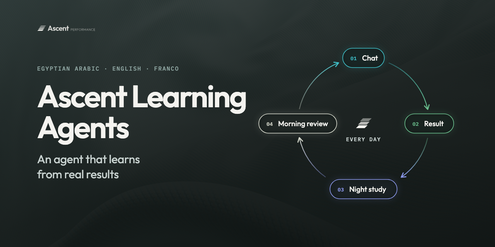

# Ascent Learning Agents

An agent that learns from real results, starting with the front desk. One inbox for all your sales channels, WhatsApp first, in Egyptian Arabic, English and Franco. Built for the Meta Global AI Developer Hackathon.

*Being built during the hackathon, 28 October to 4 November 2026. This page grows as each part works.*

## What it does

A front desk for an online store that runs on WhatsApp, day and night. Customers write the way they talk, in Egyptian Arabic, English or Franco, by text or voice note.

Built: it answers from the store's real data on products, sizes and stock level (in stock, few left or out), checks every amount in a reply against the store and delivery data before it goes out (any number next to a currency or price word, and any other number of 3 or more digits that is not an order number, phone number or date), and hands the chat to a person when it should. Coming: delivery fee and delivery days by governorate as a tool it can call, finding the customer's order from their WhatsApp number instead of asking for it, placing new orders as Shopify drafts, flagging cash on delivery orders that look risky, and cancelling at the courier when asked.

## How it learns

The product is the learning itself. It learns in two ways: from every chat and its real result, and from a study of the market, other brands and expert books. Whatever model it runs on gets better over time.

The loop runs every day:

1. Chat: the front desk answers in seconds, using only lessons that already passed the checks. Nothing is learned during a live chat.
2. Result: each chat is matched to what really happened. Ordered, delivered, returned or cancelled.
3. Night study: while the store is quiet, it reads the day, studies the market, other brands and books, and writes small lesson and idea cards. A fixed test set must pass before any lesson goes in.
4. Morning review: the owner checks about 10 replies the agent picked, marks each one Good or Fix with a line on why, and says yes or no to the idea cards. Tone fixes go in after the checks. Prices, policies and promises wait for the owner's yes.

In the first language test, five fixes from one morning review removed those phrases from all 50 replies that followed.

## Layout

```
channels/       one file per channel; WhatsApp today
frontdesk/      the first agent
  instructions.md   the store voice and wording rules
  stages.py         where the chat is, and which tools each stage offers
  loop.py           one turn: lessons, model, tools, send check
kit/            building blocks every agent uses
  tools/            one file per tool, each with its own checks
  send_check.py     runs on every reply before it goes out
  chats.py          every chat saved step by step, resumable, branchable
  model.py          Muse Spark Open on Baseten
learning/       the learning layer any agent plugs into
  results.py        every turn and its outcome
  lessons.py        one line each, never rewritten
tests/          offline tests on a scripted fake model; probes/ for live checks
docs/           how it learns
```

Each turn the model sees only the tools for the chat's stage, sent fresh every time:

| Stage | Tools today |
|---|---|
| Asking (price, size, stock) | store, voice_note, handoff |
| Ordering (wants to buy) | store, voice_note, handoff |
| My order (where is it, cancel) | voice_note, handoff |
| With a person | none, the agent waits |

Coming: delivery, draft orders, COD risk, order lookup and cancel join their stages as their files land. Built: a small switch_stage tool moves the chat when the customer moves on, and handoff moves it to a person. Customers can send text, voice notes and photos.

## Run it

1. Copy `.env.example` to `.env` and fill in the keys. Keys only ever come from `.env`.
2. From the repo folder: `python3 -m channels.whatsapp`. It listens on 127.0.0.1:8080 (set `PORT` to change it).
3. WhatsApp has to reach that port from the internet, so it needs a public tunnel or a host. Set the tunnel's URL plus `/webhook` as the webhook in the Meta app, with the verify token from `.env`.

Python 3.14, standard library only. Tests run offline on a fake model: `python3 -I -m unittest`. To check the live model, run `python3 -I tests/probes/tools_probe.py` and `python3 -I tests/probes/voice_probe.py note.ogg`.

## What comes next

Built: stage 1, reading lessons. Coming: a light stage 2 that merges lessons into principles, by Sun 1 November, and stage 3, which trains proven lessons into the model itself. After the front desk come marketing, stock and returns agents on the same layer, sharing lessons, and Instagram and Messenger on the same front desk. The full plan, and how each stage is proven: [docs/HOW-IT-LEARNS.md](docs/HOW-IT-LEARNS.md).

## Credit

The one-file-per-tool shape is inspired by Meta's [legal-agent-workshop](https://github.com/meta-models/legal-agent-workshop) (see also [issue 4](https://github.com/meta-models/legal-agent-workshop/issues/4)).
